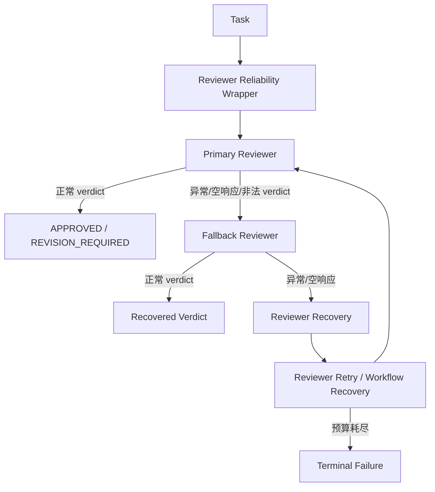
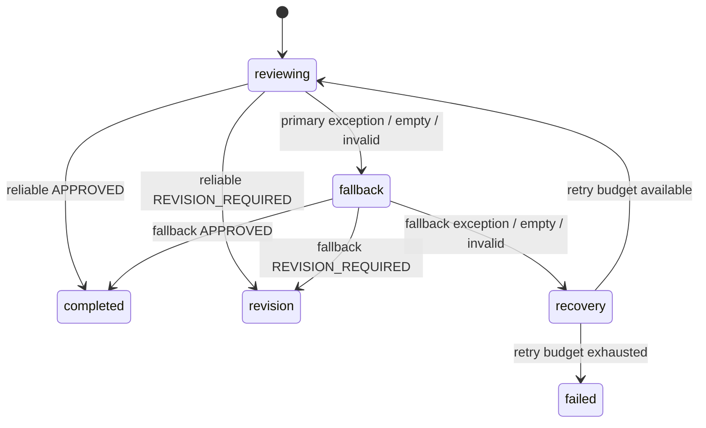
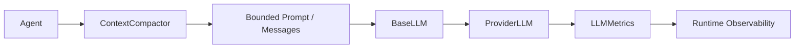
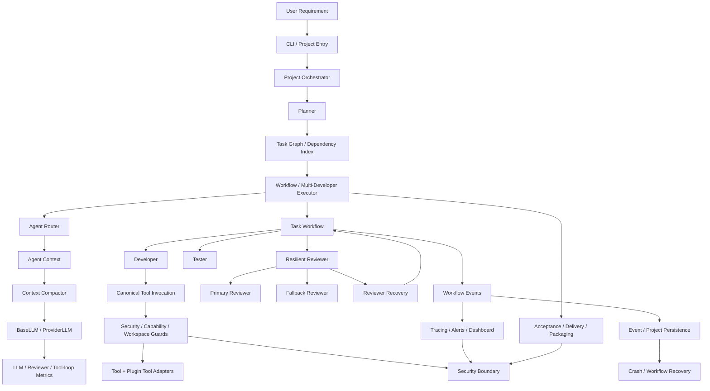

# AI-Team 最新代码与文档更新说明

> 文档版本：1.1
> 更新日期：2026-10-15
> 最新主线：`main`
> 合并提交：`c2a1731a8cb6608b5fa4e0f0266760d6509de7e9`
> 来源分支：`feature/reviewer-reliability-fallback`
> 来源提交：`5639df1ce452247a0ba7f11a5ab0afed62fb0a44`
> 说明：本文件是原六份逆向工程文档的最新代码增量说明；当原文与本文冲突时，以本文和 `main` 当前源码为准。

## 1. 本次基线变更

`feature/reviewer-reliability-fallback` 已经合并进入 `main`。本次合并不是简单增加 Reviewer Prompt，而是把 Reviewer 可靠性、失败恢复、生产架构、扩展边界、持久化一致性、工具调用边界、上下文压缩和运行时观测能力纳入同一运行时基线。

当前主线的 Reviewer 执行链应理解为：



## 2. Reviewer Reliability 设计

### 2.1 核心实现

核心实现位于 `runtime/reviewer_reliability.py`，主要对象：

- `ReviewerReliabilityStats`
- `ResilientReviewerAgent`
- `create_reviewer_with_fallback()`

`ResilientReviewerAgent` 保持 `role="reviewer"`，并代理原 Reviewer 的 `config`、`llm` 和 `build_context()`，因此不会破坏既有 `AgentRouter`、配置和上下文契约。

### 2.2 Primary → Fallback → Recovery

正常路径：

1. 调用 Primary Reviewer。
2. 返回非空合法结果则直接完成。
3. 如果抛异常、返回空响应或无法形成可靠 verdict，则记录 primary failure。
4. 如果配置了 fallback reviewer，则执行轻量兜底审核。
5. fallback 返回有效 verdict 后，结果标记 `source=fallback`、`recovered=true`。
6. fallback 也失败时，返回 `revision` 状态的 recovery result，由 Workflow 负责再次执行 Reviewer recovery/retry，而不是直接把基础设施故障误判为业务失败。

### 2.3 可靠性指标

`ReviewerReliabilityStats` 记录：

| 指标 | 含义 |
|---|---|
| `primary_attempts` | Primary 尝试次数 |
| `primary_successes` | Primary 成功次数 |
| `primary_failures` | Primary 失败次数 |
| `fallback_attempts` | Fallback 尝试次数 |
| `fallback_successes` | Fallback 成功次数 |
| `fallback_failures` | Fallback 失败次数 |
| `empty_responses` | 空响应次数 |

结果的 `data` 中还会携带：

- `reviewer_execution.source`
- `reviewer_execution.recovered`
- `reviewer_execution.primary_error`
- `reviewer_reliability`

这些字段属于运行时证据，不应被文档或上层逻辑解释为 Reviewer 的业务结论本身。

## 3. Fallback 配置

Fallback 是可选能力。只有同时配置 Provider 和 Model 时才创建 fallback Reviewer：

```text
REVIEWER_FALLBACK_PROVIDER=<provider-profile>
REVIEWER_FALLBACK_MODEL=<model-id>
```

Fallback 使用专用的可靠性优先 System Prompt，限制最大输出预算，并只向模型提供最小质量门禁所需证据：

- Task ID / Title / Requirement
- `files_changed`
- `tests`
- `validation`
- Tester result

Fallback 的策略是 **deny-by-default**：证据不足时返回 `REVISION_REQUIRED`，而不是冒险批准。

## 4. Reviewer Workflow 状态语义变化

旧文档中“Reviewer 异常 → 直接失败”的表述不再完整。

当前应区分三种情况：



因此，Reviewer 基础设施故障与业务审核结论被明确解耦。

## 5. Agent 层的上下文与安全边界

最新 Reviewer、Architect、Developer 等 Agent 已进一步使用 `security.prompt_injection.untrusted_content()` 包装来自任务、历史、依赖、测试结果和开发结果的非可信内容。

设计原则：

1. 系统指令与数据上下文必须有明确边界。
2. Developer/Tester/Reviewer 的结果不能被自动提升为系统指令。
3. Reviewer fallback 只读取最小证据集。
4. 任何用户/模型产生的字符串都不能通过字符串拼接获得更高权限。

因此，原详细设计中的“Context 隔离”应升级为：

`Role-scoped Context + Untrusted Content Boundary + Bounded Evidence`。

## 6. 上下文压缩与 LLM Metrics

当前 `runtime/context_compaction.py` 提供统一上下文预算控制：

- `AI_TEAM_MAX_PROMPT_CHARS`：默认 `24000`
- `AI_TEAM_MAX_INPUT_TOKENS_PER_CALL`：默认 `12000`

`ContextCompactor` 对 messages 做优先级压缩：

- System message 不作为普通候选压缩。
- 较旧的 tool output 优先压缩。
- assistant 历史其次。
- 较旧 user 消息再次。
- 最新 user 请求优先保留。
- tool-call metadata 不因内容压缩而丢失。

`runtime/llm_metrics.py` 提供：

- LLM 调用次数
- Tool 调用次数
- LLM 总耗时
- 最大 Prompt 字符数
- 最大输入 token 估算
- 初始 Prompt 字符数
- Context growth ratio
- LLM time ratio

因此详细设计中的 LLM 调用链现在应描述为：



## 7. Developer Tool Loop 的最新边界

Developer 仍然最多执行 `50` 次 tool iteration/轮，但每次 LLM tool call 前都会经过统一的上下文压缩与 metrics 记录。

Developer 的交付证据继续包含：

- `files_changed`
- `tests`
- `validation`
- `report`

Reviewer 和 Tester 应优先使用这些结构化证据，而不是把自由文本报告视为事实。

## 8. 生产就绪门禁

当前源码提供 `tools/run_production_readiness.py` 作为集中式生产就绪入口。

门禁顺序为：

1. `security`
2. `extension-boundary`
3. `observability`
4. `persistence-recovery`
5. `full-regression`

最终必须输出：

```text
production_readiness=passed
```

任一 gate 返回非零退出码都会立即停止并返回失败。

### 8.1 推荐验收命令

```powershell
python tools/run_production_readiness.py
```

注意：本次文档同步工作只进行了源码级检查，没有在当前 ChatGPT 运行环境中执行 Windows 项目的完整 pytest/production-readiness 命令，因此不能把“代码中定义的验收门禁”表述成“本次已实测通过”。

## 9. Phase 18 生产架构增量

最新代码还包含以下生产级边界，原六份文档需要按此理解：

- canonical Tool Invocation boundary / request contract
- Task state 与 persistence consistency contract
- Developer tool-loop decision / telemetry / evidence
- host-owned Plugin `tools` / `agents` / `workflow` adapters
- extension compatibility 与 security-boundary regression
- workflow/project recovery 与 checkpoint 相关组件
- observability / alert / dashboard 组件
- artifact store 与大输出归档
- dependency graph/index/scheduler 的扩展实现
- model governance / budget / cost / usage 组件
- multi-developer / multi-process execution 组件
- crash recovery / failure recovery / timeout recovery
- delivery audit / manifest / packaging / reconciliation

这些能力已经属于 `main` 的代码基线，不应再作为“未来规划”描述；具体是否在默认 CLI 路径自动启用，仍应以对应入口和配置为准。

## 10. 最新架构总图



## 11. 文档更新规则

本增量文档与此前六份文档的关系：

- 《详细设计说明书》：以本文件第 2～10 节覆盖 Reviewer、Context、LLM metrics、生产架构相关旧描述。
- 《架构图与流程图》：应采用本文件第 4、6、10 节的新 Reviewer fallback/recovery 与 ContextCompaction 流程。
- 《接口与实现参考》：应增加 `ReviewerReliabilityStats`、`ResilientReviewerAgent`、`create_reviewer_with_fallback`、`ContextCompactor`、`LLMMetrics` 等接口。
- 《部署运维手册》：应增加 `REVIEWER_FALLBACK_PROVIDER/MODEL` 和 `python tools/run_production_readiness.py`。
- 《用户使用手册》：应说明 Reviewer 出现基础设施异常时可能自动 fallback/recovery，用户看到的 `REVISION_REQUIRED` 不一定意味着代码本身存在缺陷。
- 《项目文档索引》：本文件作为最新代码基线补充，并以 `main@c2a1731a8cb6608b5fa4e0f0266760d6509de7e9` 为当前代码文档基准。

## 12. 最终代码基线

从本次更新开始，项目文档中的“当前版本”统一指：

```text
repository: rexyll/AI-Team
branch: main
commit: c2a1731a8cb6608b5fa4e0f0266760d6509de7e9
source branch: feature/reviewer-reliability-fallback
source commit: 5639df1ce452247a0ba7f11a5ab0afed62fb0a44
```

任何后续代码变更都应以新的 commit SHA 更新文档基线，避免文档继续以旧的 `056e2d...` 作为当前实现描述。 
