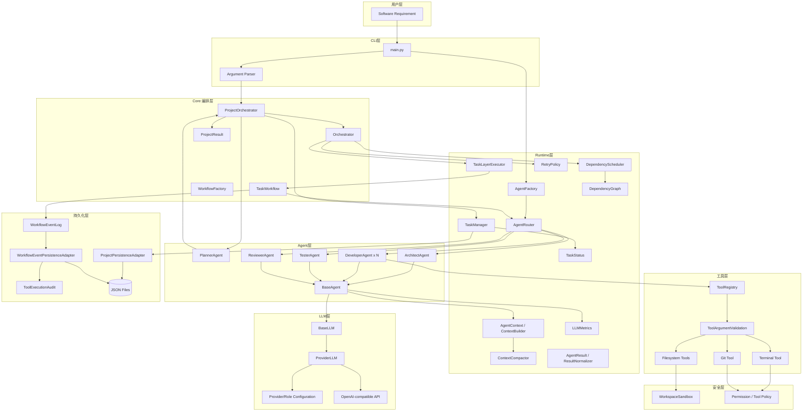
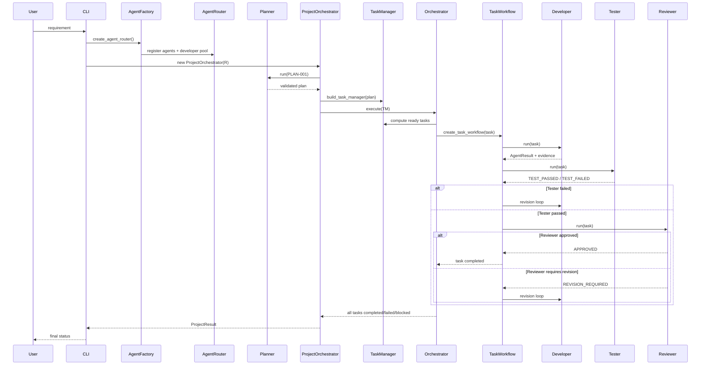
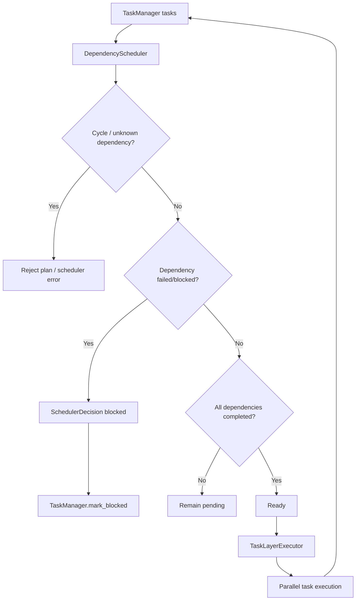
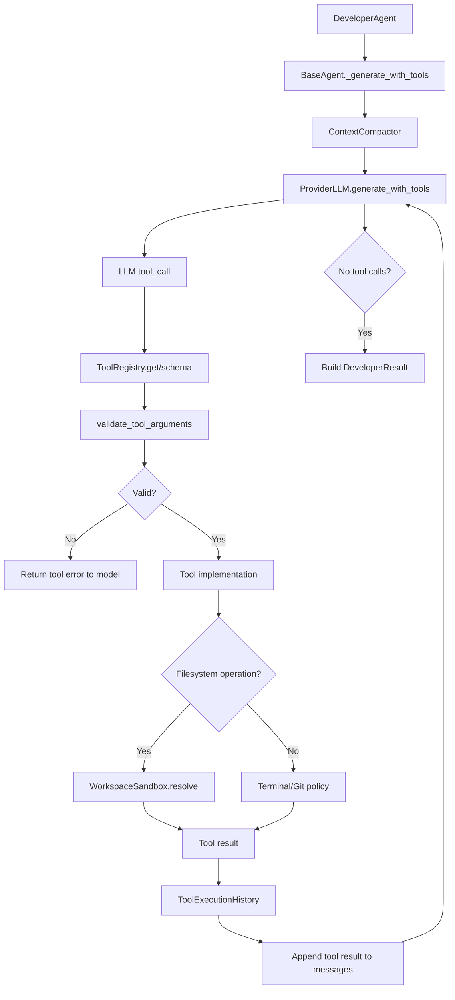
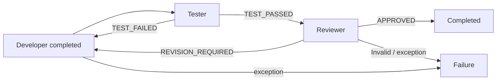
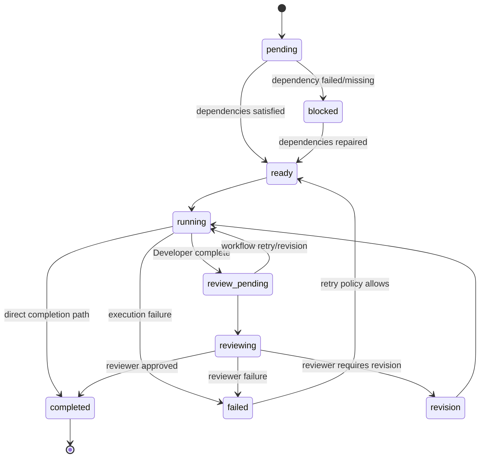
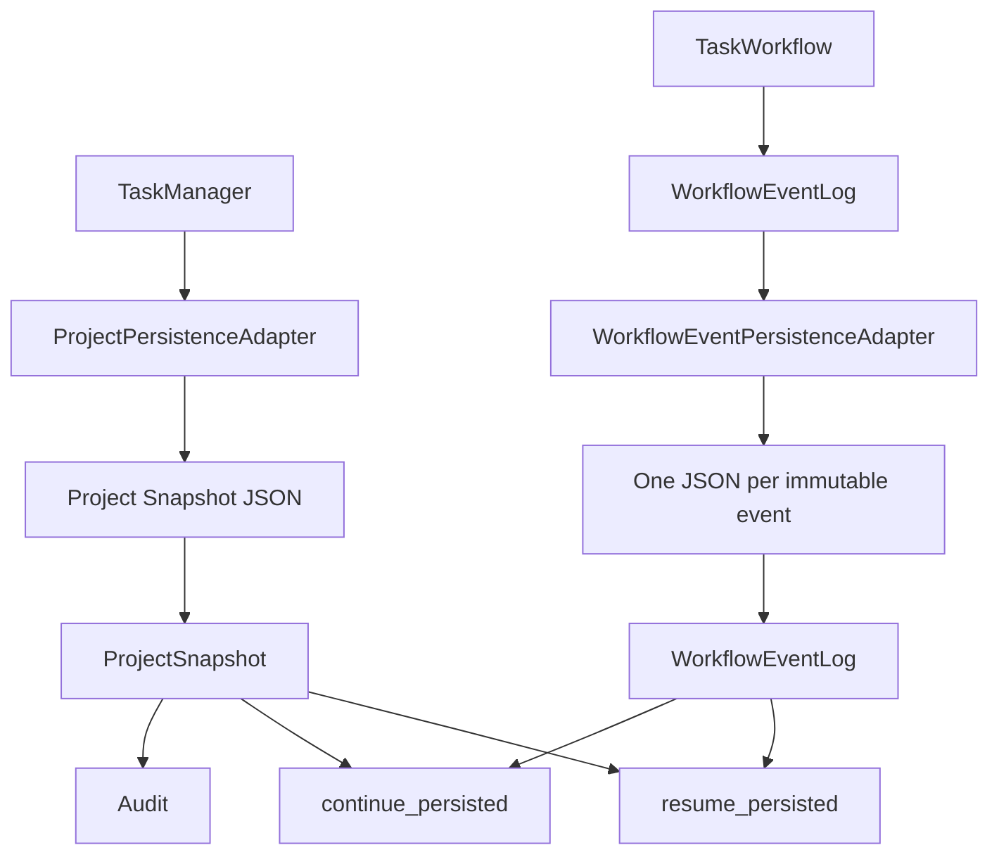
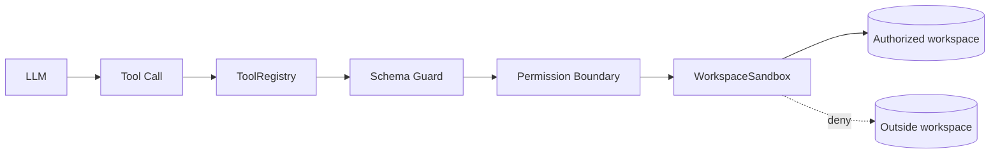

# AI-Team 架构图与流程图

## 1. 完整逻辑架构图



## 2. 项目级执行时序



## 3. 依赖调度流程



## 4. Developer 工具调用流程



## 5. 质量门禁流程



## 6. 状态机图



## 7. 持久化架构



## 8. 恢复流程

```mermaid
flowchart TD
    A[continue_persisted(project_id)] --> B[ProjectPersistenceAdapter.load]
    B --> C[Restore Plan]
    B --> D[Restore TaskManager]
    B --> E[Restore ToolExecutionHistory]
    A --> F[WorkflowEventPersistence.load_log]
    C --> G[Rehydrate ProjectOrchestrator]
    D --> G
    E --> G
    F --> G
    G --> H[Attach event persistence]
    H --> I[Execute unfinished tasks]
    I --> J[State checkpoint]
    J --> K[Atomic project snapshot update]
```

## 9. 安全边界图


