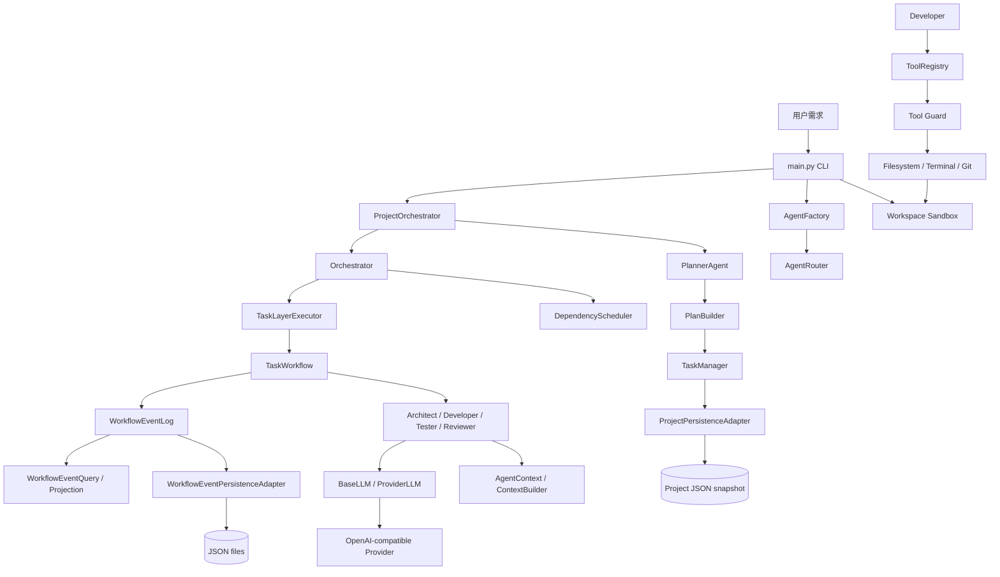
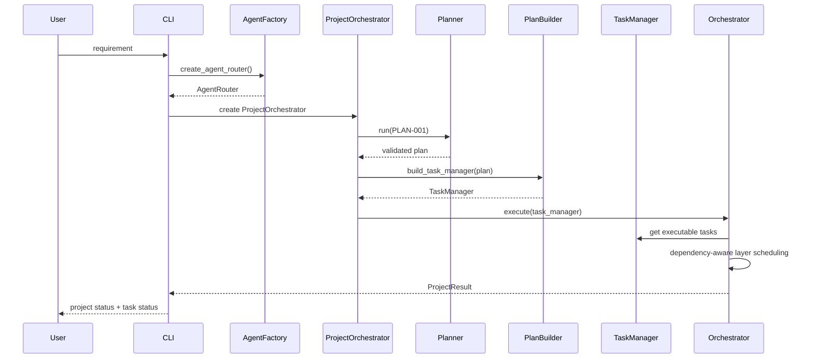
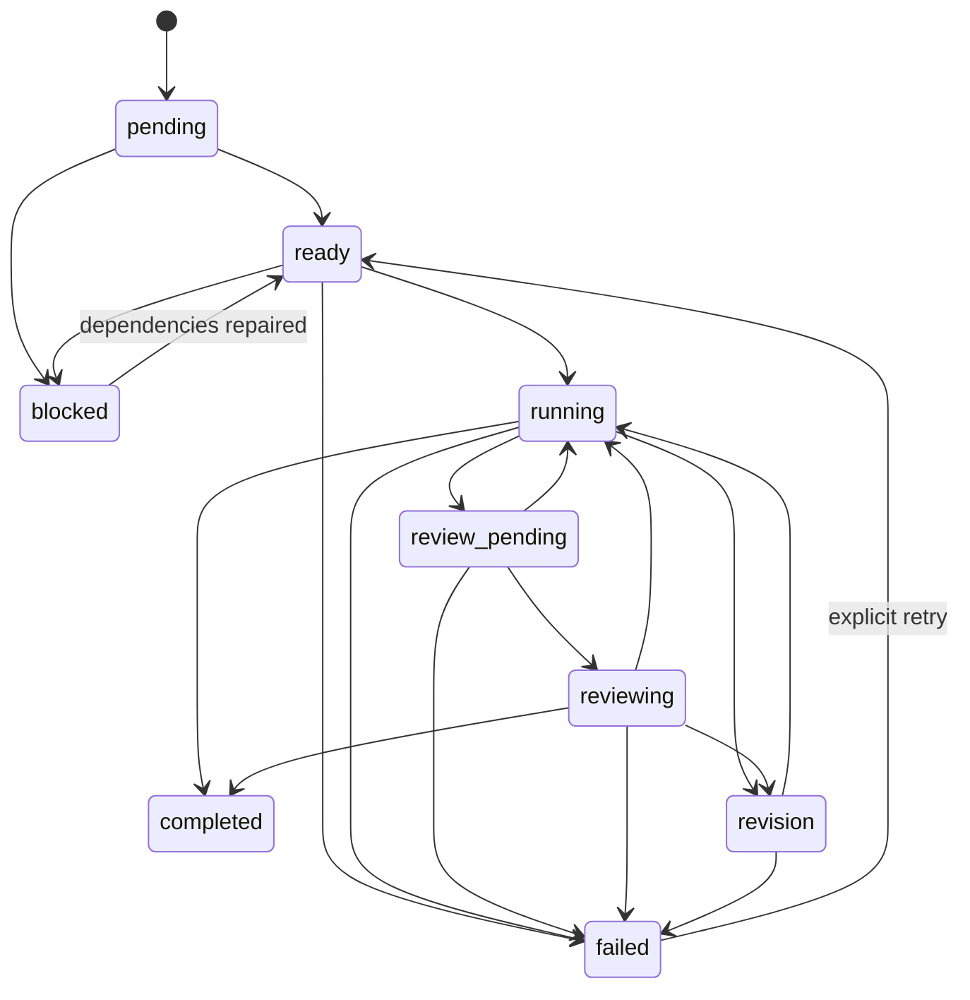
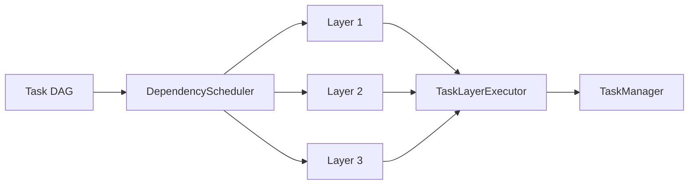
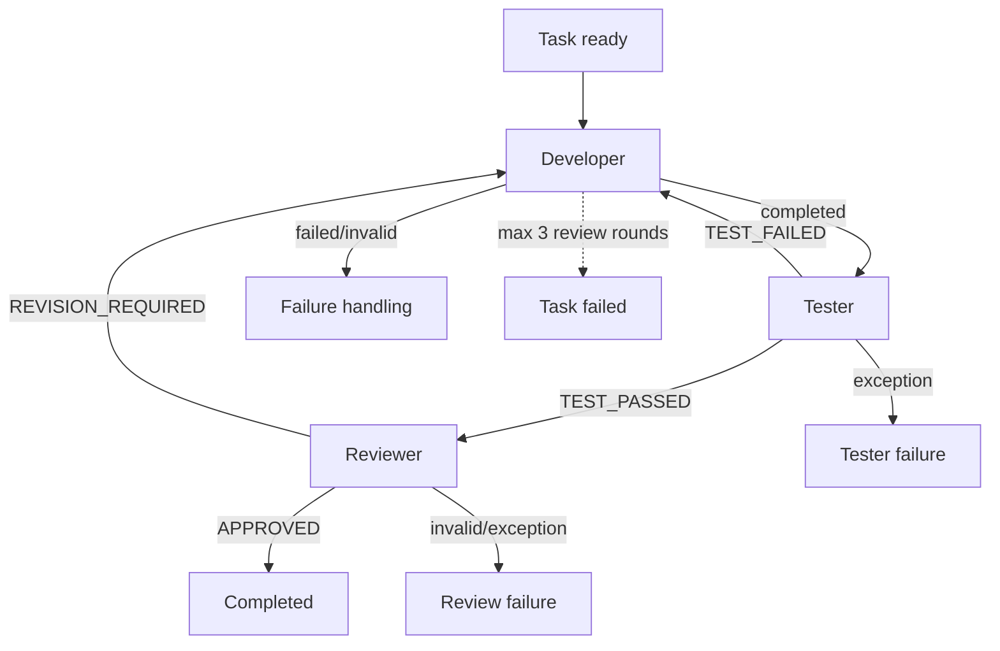
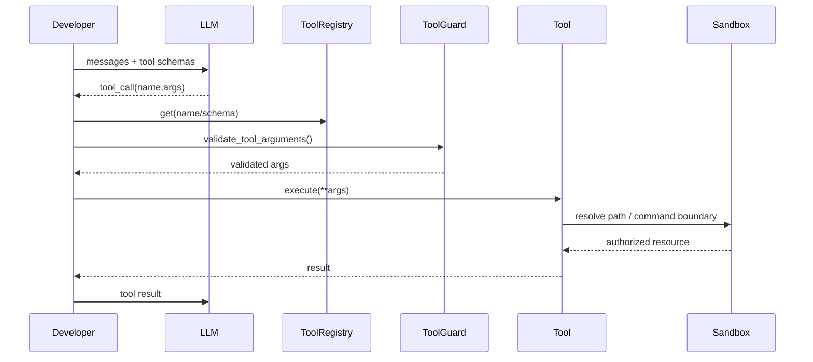

# AI-Team 详细设计说明书

> 文档版本：1.0
> 基准分支：`main`
> 基准提交：`05639a1c4a94bcded64b9ab20c99e7105673712e`
> 编制方式：基于仓库当前源码、已有运行文档和契约测试结构反向分析

## 1. 文档目的

本文档描述 AI-Team 当前实现的真实软件架构、模块职责、核心对象、任务生命周期、Agent 协作、LLM 调用、工具执行、安全边界、持久化、恢复、错误处理及接口契约。文档以源码行为为准；已有 README、DevPlan 和 docs 仅用于补充运行语义。

## 2. 系统定位

AI-Team 是一个面向软件开发任务的多 Agent 编排运行时。用户输入项目需求后，系统首先由 Planner 将需求转换为带依赖关系的任务计划，再由项目级 Orchestrator 调度任务。Architect 负责架构设计，Developer 负责实际文件/命令操作，Tester 负责基于开发证据的质量门禁，Reviewer 负责最终批准或要求返工。

当前实现的核心闭环为：

`Requirement → Planner → Task Graph → Orchestrator → Architect/Developer → Tester → Reviewer → ProjectResult`

系统不是单纯的“多个 Prompt”，而是由任务状态机、依赖调度、Agent Router、工具注册与安全校验、Workflow Event、持久化及恢复机制共同构成的运行时。

## 3. 总体架构



## 4. 分层设计

### 4.1 CLI 层

`main.py` 是当前命令行入口。它负责参数解析、工作区根目录设置、创建 Agent Router、创建 ProjectOrchestrator、执行项目以及打印 ProjectResult 和最终任务状态。CLI 不直接执行 Agent 逻辑。

### 4.2 Core 层

- `core/project_orchestrator.py`：项目级入口，串联规划、TaskManager 构建、Orchestrator 执行和恢复。
- `core/orchestrator.py`：运行时调度循环，负责依赖就绪任务发现、并行层执行、失败/重试和 Workflow 调用。
- `core/workflow_factory.py`：创建标准 Developer → Tester → Reviewer Workflow。
- `core/project_result.py`：项目级执行结果模型。

### 4.3 Agents 层

- `PlannerAgent`：需求 → JSON 计划，并进行格式、Schema、依赖和路径约束验证。
- `ArchitectAgent`：基于 AgentContext 输出架构、数据模型、模块、接口、技术决策和风险。
- `DeveloperAgent`：通过工具调用读取、修改、测试工作区。
- `TesterAgent`：只审查已有测试证据，输出 `TEST_PASSED` / `TEST_FAILED`。
- `ReviewerAgent`：综合需求、架构、开发结果、测试证据和安全/可运行性判断，输出 `APPROVED` / `REVISION_REQUIRED`。

所有 Agent 继承 `BaseAgent`，共享 LLM、ContextCompactor、LLM Metrics 和 AgentContext 构建能力。

### 4.4 Runtime 层

Runtime 是当前系统的核心基础设施层，包括：

- AgentConfig / AgentFactory / AgentRouter
- Task / TaskManager / TaskStatus
- AgentContext / ContextBuilder / ContextView / ContextCompaction
- DependencyGraph / DependencyScheduler
- TaskExecutor / Workflow
- ResultNormalizer / AgentResult
- RetryPolicy
- WorkflowEvent / WorkflowEventLog / WorkflowEventPersistence
- ProjectPersistence / ExecutionHistory / ToolExecutionHistory
- LLM abstraction / Provider adapter / metrics

### 4.5 Tools 与 Security

Developer 不能直接获得任意文件系统权限。模型请求首先进入 ToolRegistry，再经 `security.tool_guard.validate_tool_arguments()` 做 Schema 校验，随后进入文件、终端或 Git 工具；文件工具又通过 `WorkspaceSandbox` 强制路径必须位于授权工作区。

## 5. 项目启动流程



## 6. Planner 设计

### 6.1 输入

`ProjectOrchestrator.create_plan(requirement: str)` 创建 `PLAN-001`，role=`planner`，description 为用户需求。

### 6.2 输出

Planner 要求模型只输出 JSON Object，字段为：

```json
{
  "project": "项目名称",
  "summary": "项目摘要",
  "tasks": [
    {
      "id": "TASK-001",
      "title": "任务名称",
      "description": "任务描述",
      "role": "architect",
      "dependencies": []
    }
  ]
}
```

允许角色：`architect`、`developer`、`tester`、`reviewer`。

### 6.3 验证

Planner 先提取 JSON，再调用 `validate_plan()`。验证内容包括根对象、非空 project/summary、任务唯一 ID、合法角色、依赖存在性、自依赖、重复依赖和循环依赖。需求中明确的目录/路径约束还会通过 `extract_required_paths()` 与 `apply_path_constraints()` 做结构性补强。

### 6.4 自修复

默认最多 2 次 retry，因此最多 3 次生成尝试。验证失败后，Repair Prompt 会携带错误类型、原始需求和上一轮输出，要求重新生成完整计划。

## 7. Task 数据模型

`runtime.task.Task` 是任务的持久化核心对象。

| 字段 | 含义 |
|---|---|
| id | 唯一任务 ID |
| title | 任务标题 |
| description | 任务描述 |
| role | Agent 角色 |
| status | 当前生命周期状态 |
| status_history | 状态迁移记录 |
| error | 当前错误 |
| review_round | Reviewer 轮次 |
| dependencies | 前置任务 ID |
| result | Developer/普通 Agent 结果 |
| context | 运行时上下文 |
| review_result | 最新审核结果 |
| review_history | 审核历史 |
| test_result | 最新测试结果 |
| test_history | 测试历史 |
| retry_attempt | 已用重试次数 |
| max_retries | 最大重试次数 |
| retry_history | 重试记录 |

Task 可以通过 `to_dict()` / `from_dict()` 做 JSON 安全序列化与恢复，并在恢复后执行 contract validation。

## 8. Task 状态机

当前状态集合：

`pending, ready, running, review_pending, reviewing, revision, completed, failed, blocked`

核心合法迁移：



`TaskManager` 是唯一生命周期变更边界。它使用 `RLock`，将状态校验、history 追加和状态赋值放在同一临界区，避免并行 Worker 对同一状态产生竞争。

## 9. 依赖图与调度

`DependencyScheduler` 只负责“决策”，不修改 Task；`TaskManager` 负责实际状态变更。这一职责分离是并行执行和一致性的关键。

调度过程：

1. 根据 Task dependencies 构建 DAG。
2. 校验所有依赖存在。
3. 进行拓扑排序，发现循环即拒绝。
4. 找出依赖全部 `completed` 的任务。
5. 对依赖失败/阻塞的任务生成 blocked decision。
6. Orchestrator 将 blocked decision 应用到 TaskManager。
7. 就绪任务组成一层，由 TaskLayerExecutor 并行执行。



Developer 多实例通过 `AgentRouter.get_developer_for_task(task_id)` 对 Task ID 做 SHA-256，并按 pool 长度取模，得到确定性分配结果。因此相同 Task ID 在同一 Developer pool 配置下具有稳定的开发者映射。

## 10. Agent Router

`AgentRouter` 管理单例角色与 Developer pool。

默认核心角色：

- planner
- architect
- developer
- tester
- reviewer

`register()` 禁止重复 role；`register_developer_pool()` 要求 pool 非空且所有成员 role 都是 developer。开发者池可以通过 `DEVELOPER_COUNT` 环境变量配置。

## 11. AgentContext 与上下文隔离

Architect、Tester、Reviewer 和 Developer 都通过 `ContextBuilder` 获取任务上下文。Context 中包含任务基本信息、依赖上下文、任务结果、历史、metadata、测试反馈和 Reviewer 反馈等。

Developer 在返工时可读取上一轮 Reviewer feedback；Tester 只能看到开发结果和测试证据；Reviewer 使用受限后的 Developer Result，从而减少无关上下文和提示注入面。

`BaseAgent` 在真正调用 LLM 前通过 `ContextCompactor` 对 prompt 或 messages 做边界压缩，并记录压缩后的字符数、token 估算和耗时指标。

## 12. 标准 TaskWorkflow

标准 Workflow 由 `core.workflow_factory.create_task_workflow()` 创建：

`Developer → Tester → Reviewer`

Developer 通过后进入 Tester；Tester 缺失时显式标记 `tester_skipped`；Tester 失败则进入下一轮 Developer；Tester 通过后进入 Reviewer；Reviewer APPROVED 后完成，REVISION_REQUIRED 则重新进入 Developer。默认最大审核轮次为 3。



### 12.1 Developer

Developer 是唯一直接执行项目文件和命令的标准 Agent。工具调用最多 50 次/轮。若模型最终没有产生任何 tool call、文件修改或命令执行，则判定为 `failed`，防止“只输出文字但声称完成”的假完成。

Developer Result 至少包含：

- summary
- files_changed
- tests
- validation
- report

其中 validation 记录 tool_call_count、test_command_count、files_changed_count。

### 12.2 Tester

Tester 不执行修改操作。它只能依据 Developer Result 中的 tests、files_changed、summary/report 以及任务要求判断。第一行必须是 `TEST_PASSED` 或 `TEST_FAILED`。

### 12.3 Reviewer

Reviewer 综合任务要求、Architect 设计、Developer Result、Tester 结论、历史、依赖上下文和安全/可运行性检查。第一行必须是 `APPROVED` 或 `REVISION_REQUIRED`。

Reviewer 会对 Developer Result 做长度边界控制，默认 `REVIEWER_MAX_DEVELOPER_RESULT_CHARS=16000`，避免超长结果无界进入审核上下文。

## 13. LLM 抽象与 Provider

`BaseLLM` 定义两个主要边界：

```python
generate(prompt, *, system_prompt="", temperature=0.2, max_tokens=4096) -> str
generate_with_tools(messages, *, tools=None, tool_choice="auto") -> LLMResponse
```

`ProviderLLM` 是 OpenAI-compatible provider 适配器。Provider 与 Model 由环境变量解析，真实客户端延迟创建并按 provider 缓存。

### 13.1 重试

对于 HTTP `429/500/502/503/504` 以及空响应，ProviderLLM 会按 `LLM_MAX_ATTEMPTS` 进行重试，默认 4 次；退避基数由 `LLM_BACKOFF_SECONDS` 控制，且会读取 Retry-After。

### 13.2 多 Provider

角色 Provider 优先级：

1. `{ROLE}_PROVIDER`
2. `DEFAULT_PROVIDER`
3. 首个已声明 Provider

模型优先级：

1. `{ROLE}_MODEL`
2. `<PROVIDER>_MODEL`
3. `DEFAULT_MODEL`

Developer 额外支持：

1. `DEVELOPER_N_PROVIDER/MODEL`
2. `DEVELOPER_PROVIDER/MODEL`
3. Provider 默认模型
4. `DEFAULT_MODEL`

## 14. Tool Calling 架构

当前内置工具：

- `list_files`
- `read_file`
- `write_file`
- `move_file`
- `delete_file`
- `run_command`
- `git_command`

ToolRegistry 同时保存 implementation 和 function-call schema，并返回 schema 的独立副本。



Tool 参数在有 Schema 时严格检查：必须是 JSON object、不能缺 required、不能有 unknown argument、类型必须匹配。校验失败不会进入实际工具。

## 15. Workspace Sandbox 安全边界

默认授权根为仓库旁的 `projects/`。`WorkspaceSandbox.resolve()` 会把相对路径拼到 root 后执行 `resolve()`，再通过 `relative_to(root)` 检查最终路径是否仍在授权根下；目录穿越、绝对路径越界和符号链接解析后的越界路径都会被拒绝。

CLI 还支持需求中的显式输出目录：`extract_required_paths()` 识别路径约束后，通过 `anchor_workspace_root()` 将沙盒根锚定到指定目录的父级，使模型写入相对路径时产物自然落入要求目录。

这意味着“安全边界”不是只靠 System Prompt，而是由代码层 Sandbox 强制执行。

## 16. Workflow Event 设计

`WorkflowEvent` 是不可变事实对象，包含：

- event_id
- event_type
- project_id
- occurred_at
- task_id
- payload

payload 必须 JSON serializable。

`WorkflowEventLog` 提供线程安全的 append、append_if_absent、merge、project/task 查询和序列化。若配置 persistence sink，新事件先持久化成功，再进入内存索引。

标准成功 Developer 任务的核心事件生命周期为：

```text
 task_started
 developer_completed
 tester_skipped   (无 Tester 时)
 review_started
 reviewer_approved
```

当 Tester 存在时，可能出现 `tester_passed/tester_rejected/tester_failed`；Reviewer 返工时产生 `reviewer_revision`，失败时产生对应 failure event。

## 17. Workflow Event 持久化

`WorkflowEventPersistenceAdapter` 使用目录 + 每事件一个 JSON 文件的方式保存不可变事件。event_id 被约束为简单文件名，防止路径穿越。

写入采用临时文件、flush、fsync 和原子发布；批量写失败时会删除本批次已创建文件，从而提供确定性的 rollback 行为。`save_if_absent()` 支持幂等写：同 event_id 且内容相同视为已存在，内容不同则抛出冲突错误。

## 18. Project Persistence

`ProjectPersistenceAdapter` 保存项目快照：

```json
{
  "project_id": "...",
  "plan": {...},
  "tasks": [...],
  "result": {...},
  "tool_execution_history": [...]
}
```

Project snapshot 同样使用临时文件 + fsync + `os.replace()` 原子替换。加载时会恢复 TaskManager、ProjectResult 和 ToolExecutionHistory，并检查：

- task id 唯一性
- plan/task identity 一致性
- result/project 一致性
- completed/failed/blocked 计数一致性
- tool execution history 是否引用未知 task

## 19. 恢复模型

ProjectOrchestrator 提供：

- `resume()`：恢复当前内存 TaskManager。
- `resume_persisted()`：读取项目快照，不立即继续执行。
- `continue_persisted()`：读取快照并继续执行未完成任务，同时在状态边界更新持久化快照。
- `audit_persisted()`：读取工具执行审计。
- `audit_consistency_persisted()`：比较 canonical tool history 与 task context 中的 history。

恢复时不会假设“最后一条日志”就是完整状态，而是同时依赖项目快照和事件存储，从而避免单一事件流承担全部状态职责。

## 20. 错误处理与重试

### Planner

非法 JSON / Schema / dependency / generation failure → 最多 3 次尝试。

### Provider

429、5xx 和空响应 → Provider 层自动重试。

### Developer

工具异常进入 Tool Result 并继续交给模型；工具循环超过 50 次则抛出 RuntimeError。Developer Stage 异常由 Workflow 归一化处理。

### Tester / Reviewer

如果模型没有给出合法 verdict，Workflow 根据 `LLM_INVALID_VERDICT_ATTEMPTS` 默认允许额外重新生成；最终仍无效则按 invalid_result 处理。

### Task Retry

Orchestrator 根据 `FailureKind` 和 `RetryPolicy` 判断是否允许重新排队。TaskManager 的 `retry_task()` 是唯一可以把 FAILED 重新打开为 READY 的边界。

## 21. 并发模型

Orchestrator 使用 DependencyScheduler 产生 ready layer，再由 `TaskLayerExecutor(max_workers=4)` 执行。TaskManager 的状态读写由 RLock 保护，但锁不会覆盖实际 Agent/Tool 执行，因此不会把整个并行执行串行化。

Developer pool 分配基于 Task ID 的确定性 hash，而非共享可变 round-robin 指针，降低并发调度下的非确定性。

## 22. 项目级结果

`ProjectResult.from_task_manager()` 从 TaskManager 汇总项目状态。CLI 最终打印：

- success
- status
- completed/total
- 每个 Task 的 status、role、title
- error（如有）

## 23. 核心接口清单

| 类/函数 | 主要接口 | 职责 |
|---|---|---|
| ProjectOrchestrator | `run()` / `create_plan()` / `execute()` / `continue_persisted()` | 项目生命周期 |
| Orchestrator | `run()` | 依赖调度与任务执行 |
| AgentRouter | `register()` / `route()` / `get_agent()` / `get_developer_for_task()` | Agent 路由 |
| TaskManager | `transition()` / `get_ready_tasks()` / `mark_*()` / `retry_task()` | Task 状态唯一写入口 |
| DependencyScheduler | `get_ready_tasks()` / `decision_for()` / `get_execution_layers()` | DAG 调度决策 |
| TaskWorkflow | `execute()` | Developer/Tester/Reviewer 闭环 |
| BaseAgent | `run()` / `_generate()` / `_generate_with_tools()` | Agent 抽象 |
| BaseLLM | `generate()` / `generate_with_tools()` | LLM 抽象 |
| ProviderLLM | `generate()` / `generate_with_tools()` | OpenAI-compatible 适配 |
| ToolRegistry | `register()` / `get()` / `schema()` | Tool 注册 |
| WorkspaceSandbox | `resolve()` | 文件访问安全边界 |
| WorkflowEventLog | `append()` / `merge()` / `list_for_project()` | 事件内存索引 |
| WorkflowEventPersistenceAdapter | `save_if_absent()` / `load_log()` | 事件持久化 |
| ProjectPersistenceAdapter | `save()` / `update()` / `load()` | 项目快照 |

## 24. 安全设计原则

1. LLM 不能绕过 ToolRegistry 直接调用本地函数。
2. Tool 参数在 Schema 模式下严格验证。
3. 文件路径必须通过 WorkspaceSandbox。
4. 工作区默认与 Git 仓库物理隔离。
5. Tester/Reviewer 不具备修改文件的工具路径。
6. Developer Result、Tester evidence 和 Reviewer judgment 明确区分。
7. 持久化 ID 做 path-safe validation。
8. Event 是 immutable fact，冲突不可静默覆盖。

## 25. 当前实现边界

- 当前 CLI `run_project()` 默认只创建内存态 ProjectOrchestrator，没有自动启用 ProjectPersistenceAdapter 或 WorkflowEventPersistenceAdapter；持久化能力存在于 runtime API 和示例/契约中，需要显式接入。
- `ask_ai()` 保留了兼容旧调用路径；新架构优先使用 `ProviderLLM`。
- Planner、Architect、Tester、Reviewer 的结果主要依赖模型文本，因此契约解析和 verdict 解析是可靠性的关键。
- Developer 工具循环的真实质量取决于 provider 的 tool-calling 能力；只实现 `BaseLLM.generate()` 的 mock 会降级为文本完成。

## 26. 设计结论

AI-Team 当前已经形成一个较完整的 Agent Runtime：上层是项目编排，中间是依赖感知的任务状态机和质量门禁，下层是 LLM、工具、安全沙盒和持久化基础设施。其最重要的工程化特征不是五个角色本身，而是将“模型输出”转换成可验证的结构化状态、工具证据、事件事实和可恢复快照。
